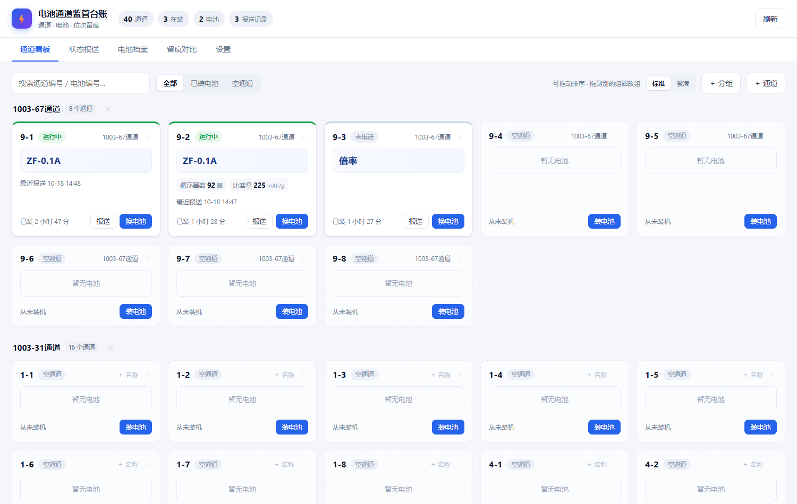
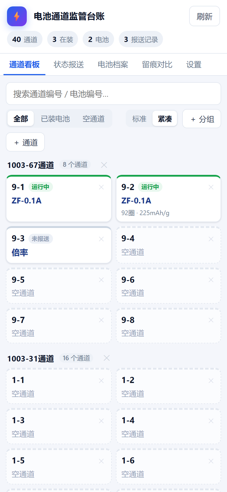
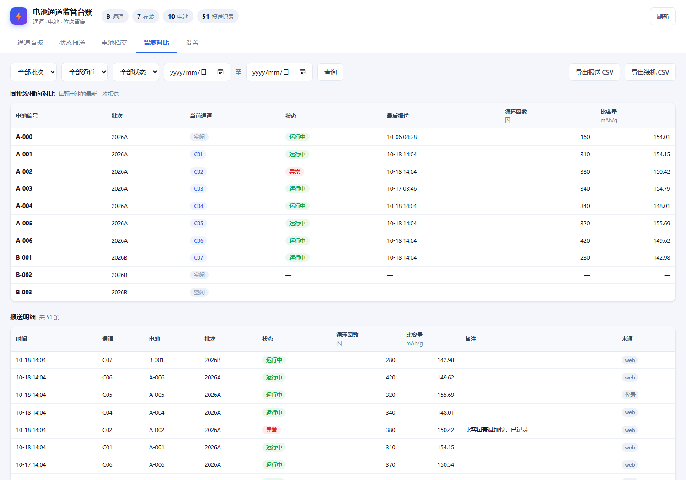
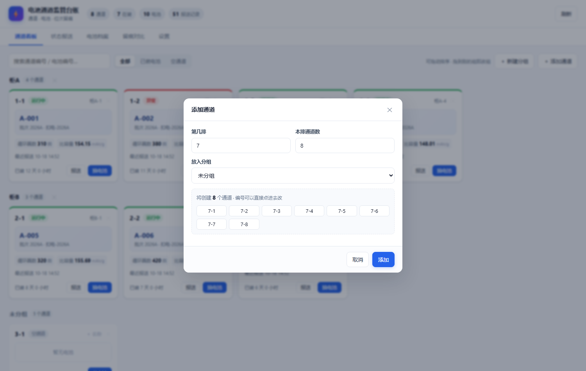
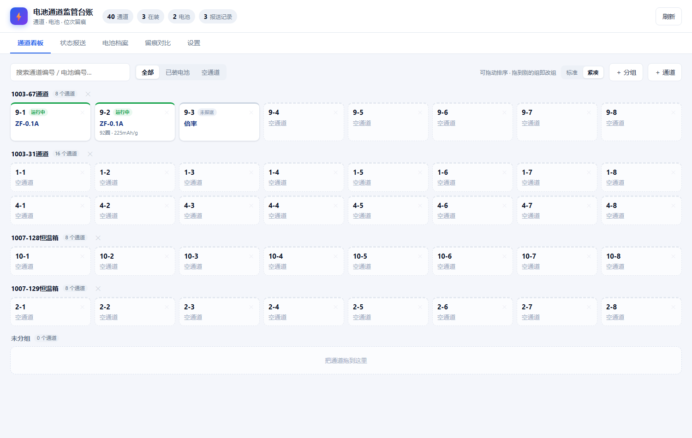
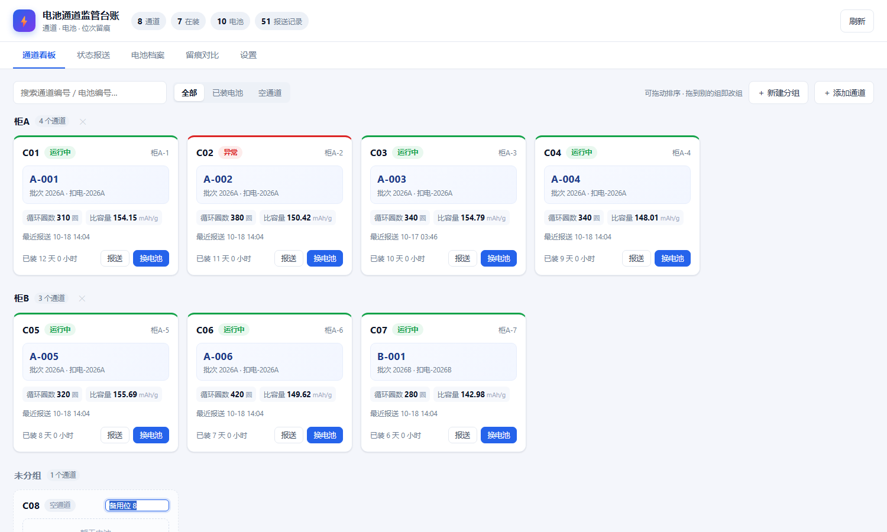

# 电池通道监管台账

记录「哪个通道上装着哪颗电池、这颗电池去过哪些通道、每次装机的结果如何」，
替代纸质笔记本，解决通道换电池后对不上号的问题。

**零依赖**：只用 Python 标准库（`http.server` + `sqlite3`），不需要 pip install。



---

## 启动

双击 **`启动.bat`**，浏览器会自动打开本机地址，同时窗口里会打印一个**手机访问地址**。

命令行方式：

```bat
cd /d D:\vibe\battery-tracker
python server.py                       :: 只允许本机
set BT_HOST=0.0.0.0 && python server.py  :: 允许同一 WiFi 的手机访问
```

- 关闭窗口或按 `Ctrl+C` 停止，数据不会丢。
- 重复启动会自动复用已在运行的实例，不会开两个。
- 端口被别的程序占用时会自动往后找（8788、8789…），**以窗口里打印的地址为准**。
- 只想像以前那样仅本机可用，双击 `启动-仅本机.bat`。

---

## 用手机打开

**不需要部署到服务器**。台账就跑在你自己电脑上，手机连同一个 WiFi 就能用：

1. 双击 `启动.bat`，窗口里会打印类似这样的一行：

   ```
   手机访问:  http://10.24.40.7:8787/    ← 手机连同一个 WiFi 打开
   ```

2. 手机连上和电脑**同一个 WiFi**，浏览器输入这个地址即可（建议加书签或「添加到主屏幕」）。
3. 电脑上改的数据，手机刷新就能看到；手机上报的数据，电脑刷新也能看到——同一个数据库。



### 手机打不开？

按顺序排查：

| 现象 | 原因 / 解决 |
|---|---|
| 页面转圈或无法访问 | 手机和电脑**不在同一个 WiFi**（比如手机走 4G、或连了访客网络） |
| 同上，但网络没问题 | **Windows 防火墙**拦了。管理员身份运行一次：<br>`netsh advfirewall firewall add rule name="battery-tracker" dir=in action=allow protocol=TCP localport=8787` |
| 地址对但连不上 | 电脑的 IP 变了（路由器重新分配）。窗口里打印的 IP 每次启动都可能不同，以最新为准 |
| 想让 IP 固定 | 在路由器里给这台电脑做「IP/MAC 绑定」，或用 `ipconfig` 记下固定地址 |

### 账号与多人使用

程序支持多用户，**每个人的数据物理隔离**——各自一个独立的数据库文件，谁也看不到谁的。

**第一次启动**会自动创建管理员账号，控制台会打印：

```
首次启动，已创建管理员账号
用户名: admin
密码:   xxxxxxxxxx
```

同样的内容也写在 `data/admin-password.txt` 里。登录后请立刻在右上角头像菜单里改掉。

**加人**：右上角头像 → 用户管理 → 填用户名、显示名、初始密码 → 创建账号。把用户名和密码告诉对方，他自己登录后再改密码。

**每个人看到什么**

| 角色 | 能看到 | 能做什么 |
|---|---|---|
| 内测用户 | 只有自己的通道、电池、报送记录 | 完全管自己的台账 |
| 管理员 | 自己的 + 可以切换查看任何人 | 建账号、重置密码、停用账号、看所有人的数据 |

管理员在头像菜单里点「查看他人数据」，选中某人后顶部会出现一条黄色提示条，这时看到的、改的都是那个人的台账。点「退出查看」回到自己。

**数据存在哪**

| 文件 | 内容 |
|---|---|
| `data/accounts.db` | 账号（用户名、密码哈希、角色），不含业务数据 |
| `data/users/u1.db` | 1 号用户的全部数据 |
| `data/users/u2.db` | 2 号用户的全部数据 |

所以「某人要退出」或「某人要迁移数据」，直接操作他那个 `.db` 文件即可，互不影响。备份只要拷 `data/` 整个目录（脚本已自动处理）。

**登录态** 用 Cookie 保存 30 天，改密码会立刻踢掉所有已登录设备。

### 实验方法库（团队共享）

顶部「实验方法」是给团队沉淀实验方法的地方：**所有人看到同一份**（不像通道台账那样按人隔离），谁都可以补充。

一篇方法包含：标题、分类、一句话简介、正文、标签、附件。

- **正文**支持简单格式：`## 小标题`、`- 列表`、`**加粗**`、`` `代码` ``、三反引号代码块
- **附件**支持拖拽上传，单文件 30 MB 以内；图片和 PDF 点击直接预览，其它格式下载
- **搜索**按标题、简介、正文、标签模糊匹配，也可以按分类筛

分类默认给了「前处理 / 涂布 / 组装 / 测试 / 表征 / 数据处理 / 其他」，新建时也能自己填。

数据存在 `data/shared.db`（正文与附件信息）+ `data/uploads/`（附件实体），**不在任何人的个人库**里，所以换人、换账号都不影响。备份脚本已经覆盖这两处。

### 要不要部署到服务器

两种用法都支持，按需要选：

| | 本机 + 局域网（默认） | 服务器 + 域名（见 [DEPLOY.md](DEPLOY.md)） |
|---|---|---|
| 适合 | 手机电脑在同一个实验室/办公室 | 出差、在家、多个地点都要看 |
| 成本 | 0 | 一台云主机 + 域名（域名需备案） |
| 速度 | 局域网直连，最快 | 走公网，够用 |
| 安全 | 不出内网 | HTTPS + 访问密码 + 只监听本机 |

服务器部署是一条命令的事：`sudo bash deploy/install.sh 你的域名 你的邮箱`，脚本会自动装 Nginx、申请免费证书、配开机自启和每日备份。

> **已经在跑、想从「公网 IP + HTTP」换成「域名 + HTTPS」**：见 [`docs/域名访问.md`](docs/域名访问.md)，一条命令 `sudo bash deploy/enable_domain.sh 域名 邮箱`。

### 装成桌面 / 手机 App

不管哪种用法，打开网页后都能「安装」成独立窗口的 App：

- **电脑 Chrome / Edge**：地址栏右侧的「安装」图标（或菜单 → 应用 → 安装此站点）
- **安卓 Chrome**：菜单 → 添加到主屏幕
- **iPhone**：Safari → 分享 → 添加到主屏幕

装好后有独立图标和窗口，没有地址栏，像原生程序。注意「安装」按钮需要 HTTPS 或 localhost 才会出现；走局域网 IP 时浏览器不给装，但可以手动把网址加书签到桌面。

---

## 第一次使用

1. 看板右上角 **「＋ 添加通道」**，填第几排、本排几个，编号会自动生成（如 `4-1 … 4-8`），一次建好一排。
2. 「设置」→ **状态字段**，当前是 **循环圈数(圈)** 和 **比容量(mAh/g)** 两个字段，可以按需增删、改单位和顺序。
3. 回「通道看板」，点任意通道的「装电池」，输入电池编号即可。

> 现在库里是**示例数据**（1-1、2-1、A-001 等），方便你先看效果。
> 确认要开始正式记录时，到「设置」→ 危险操作 → **清空全部数据**，然后建自己的通道。

---

## 日常怎么用

| 场景 | 操作 |
|---|---|
| 添加通道 | 看板右上角 **「＋ 添加通道」**，按「排」批量建，编号可改 |
| 通道上装了新电池 | 看板卡片点「换电池」，填新电池编号 |
| 电池拆下来不换新的 | 点卡片进详情，或「换电池」弹窗里的「只下机，不装新电池」 |
| 改通道编号 / 名称 | **直接点看板卡片上的编号或名称**，改完回车 |
| 删除通道 | **卡片右上角的 ✕**（不用跑去设置页） |
| 调整通道顺序 | **按住卡片拖到想要的位置**，松手自动保存 |
| 把通道归到某个组 | 把卡片**拖到那个组里**即可；也可以拖到组名上 |
| 记一次状态 | 卡片点「报送」，或到「状态报送」页 |
| 查某颗电池的前世今生 | 「电池档案」搜编号 |
| 对比同批次不同通道 | 「留痕对比」页 |
| 导出给别人 | 「留痕对比」页右上角导出 CSV |



### 在看板上添加通道

实际上每排是 8 个通道，所以这里直接按「排」来建：填 **第几排**、**本排几个**，编号自动生成 `4-1 … 4-8`。



- **排号自动接着现有往下排**：现有最大是第 9 排，打开弹窗就默认第 10 排。本排通道数默认 8。
- 虚框里每个编号都是**可编辑的输入框**，想改成 `A-1`、`4-01` 都行，点进去直接改。
- 编号**为空 / 重复 / 已存在**时会标红，标红状态不让提交，避免建出重号。
- 加完**自动跳到下一排**并刷新预览，可以连续录第 11、12 排。
- 加错了点卡片右上角的 ✕ 删掉即可。

> 设置页里的「通道管理」大列表已经去掉了——它和看板的功能完全重复。设置页现在只保留看板替代不了的部分：**已归档通道**、状态字段、状态选项、数据备份。

### 删除通道是怎么处理的

看板每张卡片右上角有个 ✕，悬停才会变明显。因为删除是不可逆的，点下去会先弹一个说明具体后果的确认框：

| 情况 | 点确认后会发生什么 |
|---|---|
| 通道**没有任何记录** | 彻底删除，无法恢复 |
| 通道**有装机/报送记录** | 从看板**归档隐藏**，历史数据一条不删，可在「设置 → 已归档通道」点「恢复」找回 |
| 删除时通道上**还装着电池** | 先把这颗电池自动下机（结果记为「通道删除」），再走上面两条 |

分组归组、改名这些都不受影响，删除只针对单个通道。

### 一屏看更多：标准 / 紧凑

工具栏右侧有 **标准｜紧凑** 切换，选择会记在浏览器里，下次打开还是上次那个。

| 模式 | 卡片内容 | 手机 390×844 一屏 |
|---|---|---|
| 标准 | 电池块、全部数值、最近报送时间、报送/换电池按钮 | 约 2 个 |
| **紧凑** | 只留「通道号 · 状态 · 电池编号 · 最新数值」 | **约 14 个** |

**手机上第一次打开自动用紧凑**，电脑上默认标准。电脑上切到紧凑，40 个通道能一屏排满，正好是每排 8 个的样子。




紧凑模式下卡片上没有按钮了，**点一下卡片会打开通道详情**，报送、换电池、整段历史都在里面。

### 分组与拖动排序

看板可以按组分区，适合「一台测试柜一个组」或者「一个房间一个组」。


| 操作 | 结果 |
|---|---|
| 顶部「＋ 新建分组」 | 建一个组，例如 `柜A`、`一层台架` |
| **拖动卡片** | 调顺序；拖到别的组里 = 换组，松手立即保存 |
| 点组名 | 就地改名（Enter 保存 / Esc 取消） |
| 组名后面的 ✕ | 删除分组。**组里的通道不会删**，只是变成「未分组」 |
| 过滤 / 搜索时 | 拖动会自动禁用，避免只重排了筛选出来的那几条 |

- 没有建任何分组时，看板就是普通的一整片卡片，不影响使用。
- 没分组的通道统一放在「未分组」区，并且在所有组之后。
- **拖动依赖桌面浏览器的鼠标操作**，手机/平板触屏暂时拖不了；要调整顺序用电脑。组和通道的增删改在手机上正常。

### 在看板上直接改名

通道编号（左边的 `C08`）和名称（右边的 `柜A-8`）都能直接点开改，不用进设置页：

| 操作 | 结果 |
|---|---|
| 点编号或名称 | 变成输入框，原值自动选中，直接打字即可 |
| 按 **Enter** | 保存 |
| 点页面上任何别的地方 | 也保存（失焦即提交） |
| 按 **Esc** | 取消，恢复原值 |

- 名称留空也可以，卡片上会显示浅色的「＋ 名称」提示位。
- 编号不能为空，也不能和已有通道重复，冲突会弹提示并保持原样。
- 点卡片其他区域仍然是打开通道时间线，不受影响。



### 界面上几个容易忽略的点

- **顶部统计**：通道数 / 在装数 / 电池总数 / 报送总数。
- **卡片顶部色条**：绿=运行、红=异常、蓝=静置、灰=停机、橙=待检、浅灰=还没报送过。
- **点卡片任意位置**：打开这个通道的完整时间线（装机经过 + 每一次报送）。
- **网址带 `#board` / `#report` / `#battery` / `#compare` / `#settings`**：刷新会停在原来的页签，也可以直接收藏某一页。

---

## 让我帮你代录

直接在对话里把数据发给我，我写进同一个数据库，你刷新网页就能看到。例如：

> C05 换了 A-007 电池，今早 9:20 上机，第 120 圈比容量 152.3

我在后台调用的是 `cli.py`：

```bat
python cli.py status                         :: 总览：各通道当前电池
python cli.py channels                       :: 各通道当前电池（简版）
python cli.py fields                         :: 当前有哪些可填字段
python cli.py groups                         :: 有哪些分组、各几个通道
python cli.py bulk-channel C01-C16           :: 批量建通道
python cli.py add-channel C05 --name 五号位
python cli.py add-group 柜A                   :: 建分组
python cli.py set-group C05 柜A               :: 把通道归组（用 - 表示移出分组）
python cli.py add-battery A-007 --batch 2026A --model 18650 --cap 2.6
python cli.py swap C05 A-007 --result 完成 --at "2026-10-18 09:20"
python cli.py checkout C05 --result 异常 --note 胀气
python cli.py snap C05 --status 运行中 --set 循环圈数=120 --set 比容量=152.3 --note "第120圈"
python cli.py timeline C05                   :: 通道历史
python cli.py profile A-007                  :: 电池档案
```

示例数据也可以重新生成：

```bat
python demo.py seed    :: 重新生成示例数据
python demo.py clear   :: 清空业务数据（字段和设置保留）
```

---

## 数据在哪

| 内容 | 位置 |
|---|---|
| 账号库 | `data/accounts.db` —— 用户名、密码哈希、角色（不含业务数据） |
| 用户数据 | `data/users/u1.db`、`u2.db`… —— **一个人一个库，复制某一个文件就备份了这个人** |
| 旧版单库 | `data/battery.db` —— 迁移到多用户前的旧库，只做备份保留，程序不再读写 |
| 网页 | `static/` |
| 程序 | `accounts.py`（账号）、`store.py`（数据层）、`server.py`（接口）、`cli.py`（命令行） |

数据库是标准 SQLite，可以用 DB Browser for SQLite 直接打开查看。

> 命令行 `cli.py` 默认读 `data/battery.db`。多用户之后要操作某个人的数据，请指定他的库：
> `BT_DB=data/users/u1.db python cli.py status`

如果想另开一个**独立实例**（比如做演示、不想动真实数据），用环境变量指定不同的库和端口：

```bat
set BT_DB=D:\demo\demo.db
set BT_PORT=8790
python server.py
```

---

## 设计说明

- **通道 × 电池是多对多历史关系**：换电池不是"覆盖"，而是结束一段 `placement`、开始新的一段，所以旧数据永远查得到。
- **一个通道同时只能有一颗电池**：数据库层用唯一索引兜底，不会出现两条"在装"。
- **分组只是归类，不影响数据**：`channels.group_id` 指向 `groups`；删组时把组内通道的 `group_id` 清空，通道本身和数据都不动。
- **排序是「组内序号」**：拖动后前端把每个组里的 id 顺序整体提交，服务端按 `(idx+1)*10` 重写 `sort_order`，留出间隔方便以后插入。
- **字段可配置**：`fields` 表决定报送表单长什么样，加字段不用改代码。字段名唯一，避免数据对不上。
- **留痕**：每条报送记录 `taken_at`（业务时间，可回填）、`created_at`（录入时间）、`source`（web / cli），谁在什么时候录的有据可查。
- **清空有确认**：清空接口必须带确认词，防止误触。

---

## 常见问题

**Q：换电池时填错了怎么办？**
A：目前可到「电池档案」核对，误录的报送条目可调用 `DELETE /api/snapshots/{id}` 删除（后续可加界面按钮）。

**Q：电脑重装 / 换电脑？**
A：整个文件夹拷走即可，`data/battery.db` 里是全部数据。

**Q：能多人同时用吗？**
A：可以。程序本身就是多用户的：局域网用法下双击 `启动.bat`（监听 0.0.0.0），同一个 WiFi 下的电脑手机都能打开，每个人用自己的账号登录，各看各的数据；服务器部署则是任何地方都能访问。
